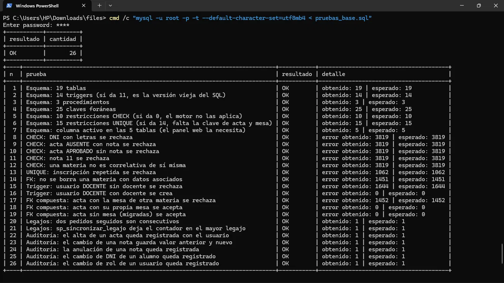
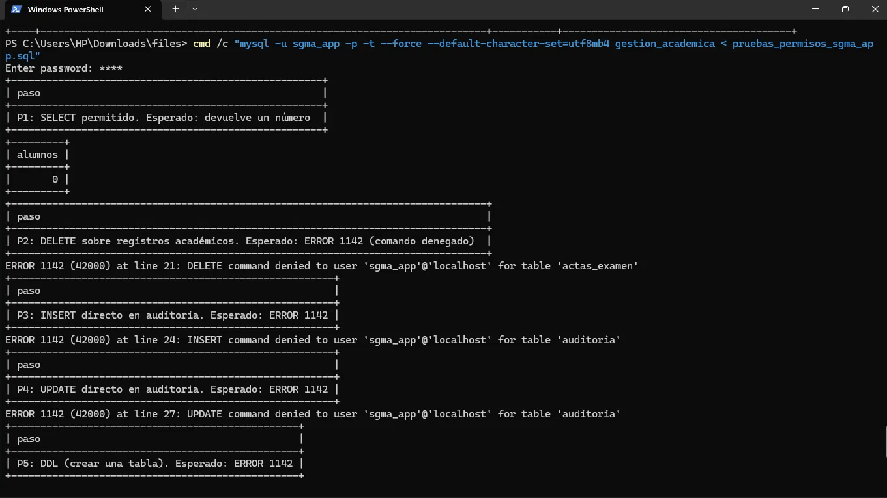
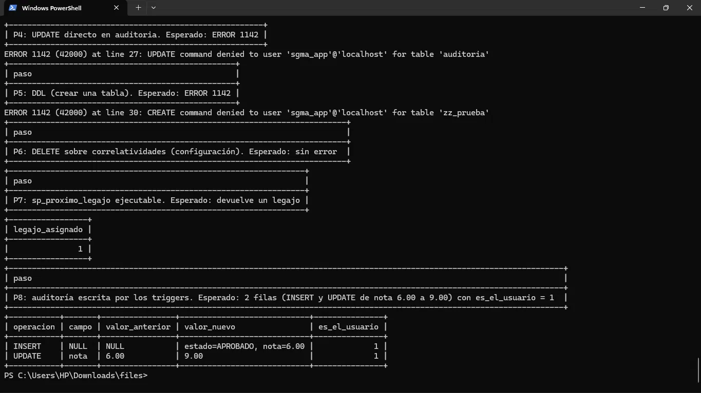
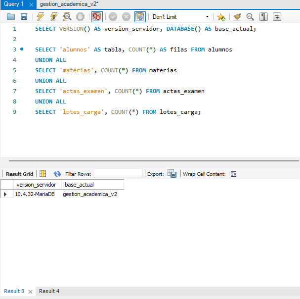
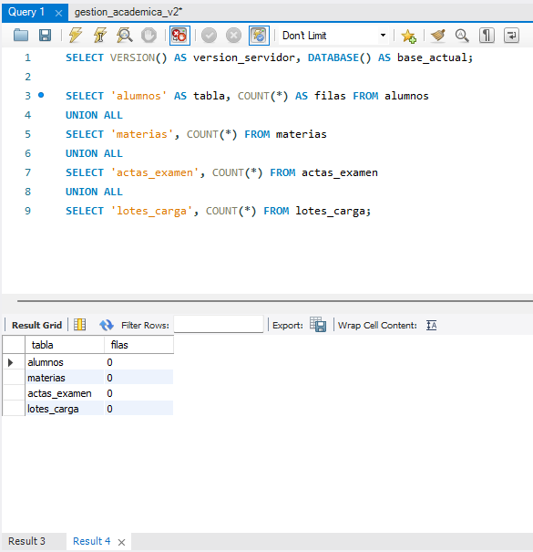

# Informe de Calidad e Integridad Referencial C5

**Proyecto:** Sistema de Gestión y Migración Académica (SGMA)  
**Fecha:** 24 de noviembre de 2026  
**Alcance:** pruebas del esquema y permisos, migración inicial, auditoría cruzada y rendimiento/concurrencia.

## Resumen

La evidencia reunida muestra que las 26 pruebas SQL del esquema terminaron en OK, que la cuenta de aplicación tiene los permisos previstos y que la migración de las planillas coincide con los conteos esperados. También se midió el costo del trigger de auditoría y una carga concurrente en bases aisladas.

Los resultados provienen de dos motores distintos. Las pruebas de esquema y permisos se ejecutaron en MySQL 8.4.13; la migración cruzada y el benchmark C4 se ejecutaron en MariaDB 10.4.32. Por lo tanto, este informe consolida evidencia para C5, pero no afirma que la migración ni el benchmark se hayan validado en MySQL 8.4.13.

## Entornos y evidencia

| Evidencia | Motor y base | Resultado |
|---|---|---|
| 26 pruebas SQL de estructura, restricciones, legajos y auditoría | MySQL 8.4.13; el nombre de la base no aparece en la captura | 26/26 OK |
| Pruebas de permisos P1–P8 | MySQL 8.4.13, mismo servidor confirmado por la persona usuaria; base `gestion_academica` | Resultados esperados observados |
| Carga ETL y auditoría cruzada C3 | MariaDB 10.4.32, base `gestion_academica_v2` | Conteos y anomalías alineados con las fuentes |
| Rendimiento y concurrencia C4 | MariaDB 10.4.32, esquemas temporales de prueba | Mediciones completadas; esquemas eliminados |

## Pruebas del esquema e integridad

La salida de `pruebas_base.sql` muestra **26 pruebas aprobadas**. La revisión de estructura informa 19 tablas, 14 triggers, 3 procedimientos, 25 claves foráneas, 10 restricciones `CHECK`, 15 restricciones `UNIQUE` y la columna `activo` en cinco tablas.

Las pruebas de comportamiento cubren validaciones `CHECK`, rechazo de inscripciones duplicadas, integridad referencial, reglas de docentes y claves compuestas de acta/mesa. También verifican la aceptación de actas históricas sin mesa, secuencia y sincronización de legajos, y eventos de auditoría para altas y cambios de notas, alumnos y roles.

**Evidencia 1.** Resultado de las pruebas SQL en MySQL 8.4.13:

## Pruebas de permisos y auditoría

La prueba de `sgma_app` se ejecutó en `gestion_academica` en el mismo servidor MySQL 8.4.13 confirmado por la persona usuaria.

- P1: una consulta `SELECT` se permitió. Devolvió cero alumnos porque el conjunto estaba vacío.
- P2–P5: se denegaron con error 1142 el borrado de actas, la escritura directa en `auditoria` y la creación de tablas.
- P6: se permitió borrar una correlatividad, según el resultado esperado de la prueba.
- P7: se permitió ejecutar `sp_proximo_legajo`; devolvió el legajo 1.
- P8: los triggers registraron un `INSERT` y un `UPDATE` de nota, ambos con el usuario 1, aunque `sgma_app` no tiene permiso de escritura directa en `auditoria`.

**Evidencia 2.** Primer tramo de la prueba de permisos:

**Evidencia 3.** Continuación de la prueba de permisos:

## Migración y auditoría cruzada C3

La vista previa del ETL había preparado 80 alumnos, 2 carreras, 24 materias y 189 actas, con 25 anomalías. Después se aplicó la migración a `gestion_academica_v2` en MariaDB 10.4.32. Workbench confirmó estos conteos:

| Entidad | Filas preparadas | Filas cargadas |
|---|---:|---:|
| Alumnos | 80 | 80 |
| Carreras | 2 | 2 |
| Materias | 24 | 24 |
| Actas | 189 | 189 |

La fila del lote de `Actas_Historicas.csv` registra 204 filas de origen, 189 correctas y 15 con error. La diferencia coincide con la clave: se omitieron 3 alumnos con DNI duplicado, 1 materia duplicada y 15 actas con referencias inexistentes, fechas inválidas/futuras o notas fuera de rango. Las anomalías de correo y fecha de nacimiento de alumnos se registraron sin descartar esos alumnos.

La base operativa quedó con 80 alumnos, 2 carreras, 24 materias, 189 actas, 190 eventos de auditoría y un lote de migración. La captura de Workbench aportada por la persona usuaria confirma las filas de las cuatro tablas y el resumen del lote.

**Evidencia 4.** Conteos de entidades migradas en Workbench:

**Evidencia 5.** Resumen del lote de actas:

## Rendimiento y concurrencia C4

Las mediciones se hicieron en MariaDB 10.4.32 sobre esquemas desechables creados a partir del DDL. La variante sin auditoría quitó solamente `trg_actas_ai`; la base operativa no se modificó.

| Medición | Con auditoría | Sin trigger de inserción de actas |
|---|---:|---:|
| Escritura y `COMMIT` del ETL real, 189 actas (mediana de 7 pares) | 0,208 s | 0,162 s |
| Escritura y `COMMIT` con 1.000 actas válidas de estrés (mediana de 5 pares) | 0,762 s | 0,560 s |
| 10 conexiones, 1.000 escrituras concurrentes tras la carga real (mediana) | 0,520 s | 0,421 s |
| p95 de inserción concurrente tras la carga real | 6,49 ms | 5,07 ms |
| p95 de búsqueda indexada por alumno tras la carga real | 5,13 ms | 4,79 ms |

La auditoría generó un evento por cada acta insertada. En la carga real fueron 189 eventos; en el ensayo sintético de 1.000 actas, 1.000 eventos antes de la concurrencia. Las 1.000 inserciones concurrentes adicionales también se registraron cuando el trigger estaba activo. Los conteos de actas coincidieron en las variantes.

Se recomienda **mantener activa la auditoría durante la migración**: el costo mediano absoluto fue de aproximadamente 46 ms para las 189 actas reales y 202 ms para 1.000 actas sintéticas. La medición sintética presentó variación entre repeticiones, con un máximo de 2,609 s. Los documentos disponibles no fijan un umbral de tiempo aprobado para RNF-02, ni se encontró la definición de RNF-10; por eso estos datos son una referencia local, no una certificación de SLA.

## Conclusión y límites

La evidencia satisface el contenido previsto para C5: pruebas de esquema 26/26, permisos y auditoría, migración contrastada con las fuentes y mediciones C4. El resultado demuestra controles funcionales en MySQL 8.4.13 y confirma el cruce ETL y rendimiento en MariaDB 10.4.32, cada uno en su entorno correspondiente.

Para una validación integral en un único motor, queda repetir la carga ETL y el benchmark C4 en MySQL 8.4.13 sobre una base de QA. También falta fijar los umbrales cuantitativos de rendimiento y recuperar la definición vigente de RNF-10. El ETL probado inserta cada acta mediante una sentencia individual dentro de una transacción; no usa inserciones multi-fila en tandas.

## Anexos y archivos de apoyo

- Las capturas de las 26 pruebas SQL y de permisos se guardan en `evidencias/C5/`.
- El informe detallado de las mediciones C4 está en `RESULTADOS_C4_RENDIMIENTO_CONCURRENCIA.md`.
- El ensayo reproducible de rendimiento está en `pruebas/benchmark_c4.py`.
